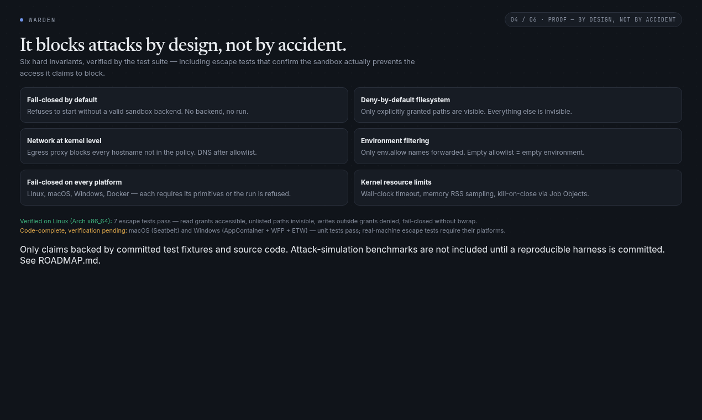
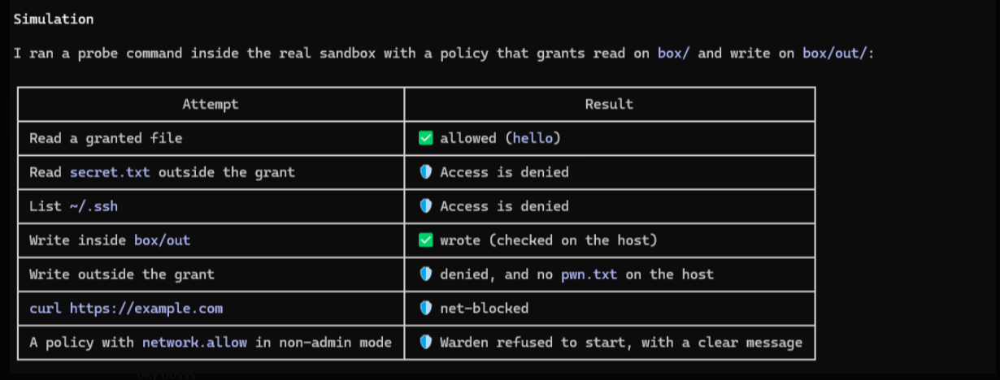

# Warden

**A fail-closed security boundary for MCP servers and other local tools.**

Warden starts a process with an explicit policy for filesystem paths, network
destinations, environment variables, and resource limits. Anything not granted
is denied. If the operating system cannot enforce the requested boundary,
Warden refuses to start the process; it never silently falls back to an
unsandboxed run.

<p align="center"></p>

<p align="center">
  <a href="https://www.npmjs.com/package/warden-sandbox-cli"></a>
  <a href="https://github.com/Prof-bilal/Warden/actions/workflows/ci.yml"></a>
  <a href="https://github.com/Prof-bilal/Warden/releases"></a>
  <a href="LICENSE"></a>
</p>

> **Status:** Warden is pre-1.0 security software. Read the [threat model and
> limitations](warden-starter/warden/docs/security.md) before protecting
> sensitive workloads. Native Windows and macOS enforcement must be verified
> on those operating systems; Linux or CI results are not substitutes.

## Why Warden exists

MCP servers are local programs. Without an isolation boundary, a server runs
with the permissions of the user who launched it: it may read credentials,
modify files, contact arbitrary hosts, or spawn child processes. Warden turns
those broad implicit permissions into a small, reviewable allowlist.

| Capability | Without Warden | With Warden |
|---|---|---|
| **Filesystem** | Host paths available to the user | Only declared read and write paths |
| **Network** | Arbitrary destinations and direct connections | Only declared hosts through the policy-aware egress path |
| **Environment** | The complete parent environment | Only names in env.allow |
| **Resources** | Unbounded runtime and memory | Backend-supported timeout and memory supervision |
| **Failure behavior** | Missing setup may leave a plain process | Missing primitives cause a loud refusal |

Warden is for **local, single-user process isolation**. It is not a
multi-tenant cloud control plane, an identity system, or protection against a
malicious kernel-level attacker.

## Install

### npm wrapper (recommended for released binaries)

~~~bash
npm install -g warden-sandbox-cli
warden version
warden doctor
~~~

The npm package installs a platform-specific Warden binary from the release
channel. warden doctor is the first gate: do not run a server until it reports
that the selected backend and required primitives are ready.

### Download or build

Download a release artifact and its SHA256SUMS file from
[GitHub Releases](https://github.com/Prof-bilal/Warden/releases), then verify
the checksum. To build the current checkout:

~~~bash
git clone https://github.com/Prof-bilal/Warden.git
cd Warden/warden-starter/warden
go build -o warden ./cmd/warden
./warden version
~~~

Source builds track the checkout and may differ from the published npm binary;
see [release parity notes](RELEASE_PREVIEW_STATUS.md).

## Five-minute secure run

Create a policy next to the server. Relative paths resolve from the policy
file's directory.

~~~yaml
# policy.yaml
command: ["node", "server.js"]
filesystem:
  read: ["./data"]
  write: ["./output"]
network:
  allow: ["api.github.com"]
env:
  allow: ["PATH", "NODE_ENV", "GITHUB_TOKEN"]
limits:
  memory_mb: 512
  timeout_s: 300
~~~

Run it:

~~~bash
warden run --policy ./policy.yaml
~~~

Or provide the command after the policy:

~~~bash
warden run --policy ./policy.yaml -- node server.js
warden logs --tail 50
~~~

The child can read data, write output, reach the explicitly allowed host, and
receive only the named environment variables. **Unlisted access is not an
implicit permission.**

## Edit with hidden credentials (development)

For coding sessions that need to edit files containing credentials, the
development CLI also provides native sanitized workspaces on Linux, macOS and Windows:

```bash
warden agent --policy agent-policy.yaml -- claude
warden agent --policy agent-policy.yaml -- codex
```

Explicitly selected dotenv, JSON, YAML and TOML fields become placeholders.
The agent can edit surrounding content; Warden requires a sanitized review
before applying edits with the original protected values preserved. The new
command requires a source build and the host's native sandbox backend. See
[agent workspace setup and limitations](warden-starter/warden/docs/agent-workspace.md).

## Trace, review, then run

Tracing is an onboarding tool, not a security boundary. It runs the command
with normal permissions while recording observed accesses. Trace only trusted
code with disposable data and fake credentials.

~~~bash
warden trace -- node server.js
warden init --log trace.jsonl --output policy.yaml
vi policy.yaml
warden run --policy policy.yaml
~~~

warden init creates a conservative starter policy from successful observed
accesses. A trace does not prove that a workload will never need another
access; keep grants narrow and test denied operations deliberately.

## Policy reference

~~~yaml
command: ["/usr/bin/node", "server.js"]
filesystem:
  read: ["./data"]       # read-only
  write: ["./output"]    # read/write
network:
  allow: ["api.github.com", "127.0.0.1"]
env:
  allow: ["PATH", "NODE_ENV"]
limits:
  memory_mb: 512
  timeout_s: 300
~~~

- **Filesystem:** read mounts read-only; write mounts read/write. The host root
  is rejected, runtime directories are not writable, and symlink traversal
  inside a granted path still requires careful review.
- **Network:** allow contains bare hostnames or IP literals, not URLs. The
  allowlist is checked before upstream DNS lookup. HTTP/HTTPS proxying is not
  raw TCP/UDP filtering.
- **Environment:** only variable names are listed; values come from the parent
  at launch. An empty list means an empty child environment. Do not pass HOME
  casually.
- **Limits:** memory and timeout enforcement is backend-dependent. **No CPU
  throttling guarantee exists.**

See the complete [schema reference](warden-starter/warden/docs/schema.md).

## Backends and enforcement

Warden chooses the strongest available backend for --backend auto and fails
closed when it cannot establish the requested boundary.

| Backend | Enforcement | Important requirement |
|---|---|---|
| **Linux** | bubblewrap namespaces, isolated networking, bind mounts, audit instrumentation | bwrap and required audit tooling |
| **macOS** | Seatbelt profiles and egress proxy | Verify on a real macOS host; Seatbelt is deprecated |
| **Windows** | AppContainer, ACLs, WFP filters, ETW auditing, Job Objects | Windows 10/11; WFP/ETW may require Administrator |
| **Docker** | isolated container, read-only root, explicit mounts, network none, proxy bridge | Running Docker daemon and compatible Linux bridge |

~~~bash
warden run --backend linux --policy policy.yaml
warden run --backend windows --policy policy.yaml
warden run --backend docker --policy policy.yaml
~~~

There is **no unsandboxed fallback**. A backend error is a failed run.

## Features

- **Deny-by-default filesystem isolation** with read-only and read/write grants.
- **Policy-aware egress control** with host allowlisting and audit decisions.
- **Environment filtering** before the child starts.
- **Fail-closed startup** when policy or OS primitives fail.
- **Process supervision** with backend-supported timeout, memory, and cleanup.
- **JSONL audit logs**, including blocked decisions and approval events.
- Trace, init, doctor, logs, and interactive approval for daily operations.
- **MCP proxy** for JSON-RPC tool/resource filtering and auditing.
- **Gateway registry** initialization, policy generation, execution, wrapping, and listing.
- **Managed connections** through connect, serve, stop, and inventory.
- **Policy packs and clients** for candidate installs, client setup, drift inspection, and undo.
- **Containers and Kubernetes** manifest rendering and validation.
- **Maintenance** reports, policy comparison, and published-binary updates.

## Command map

~~~text
warden run       Start a command inside the selected sandbox
warden trace     Record a trusted run for policy generation
warden init      Generate a starter policy from a trace
warden logs      Inspect or follow JSONL audit records
warden doctor    Check backend and host readiness
warden version   Print the installed version
warden update    Check for or install a published update
warden proxy     Run the policy-aware MCP message proxy
warden connect   Filter a sandboxed stdio MCP connection
warden serve     Serve a filtered connection over authenticated HTTP
warden stop      Stop a managed gateway connection
warden inventory Inspect configured connections and drift
warden gateway   init, run, wrap, or list gateway servers
warden packs     List and prepare candidate policy packs
warden clients   Inspect supported client configuration
warden add       Add a policy-backed server to a client
warden wrap      Apply managed client configuration
warden unwrap    Revert managed client configuration
warden k8s       Render Docker/Kubernetes manifests
warden mcp       Inspect MCP-focused workflows
warden creator   Inspect creator/evidence workflows
warden policy-diff Compare two policies
warden report    Produce a maintenance or verification report
~~~

Run warden help COMMAND for installed flags. See the [CLI reference](warden-starter/warden/docs/cli.md).

## Evidence: real sandbox checks

Evidence must distinguish **executed enforcement** from diagrams or
compile-only checks. The repository contains a reproducible Linux proof harness
and a Windows terminal capture supplied from a real Windows run.

### Linux proof



The proof harness checks allowed reads and writes, blocked filesystem access,
blocked network access, environment filtering, and fail-closed startup:

~~~bash
cd warden-starter/warden
go build -o warden ./cmd/warden
bash testdata/proof/run-proof.sh ./warden
~~~

It writes machine-readable summary.json, results.jsonl, and audit.jsonl.
See [proof documentation](warden-starter/warden/docs/proof.md),
[E2E proof results](E2E-PROOF-RESULTS.md), and the
[test-data README](warden-starter/warden/testdata/proof/README.md).

### Windows terminal evidence



This real terminal capture shows a granted read succeeding, reads outside the
grant denied, a granted write succeeding, an outside write denied, direct
network access blocked, and a network policy refused in non-admin mode rather
than running unsandboxed.

**This image records that run; it is not a substitute for a repeatable Windows
test.** Re-run [WINDOWS-TESTING.md](WINDOWS-TESTING.md) on an Administrator
Windows 10/11 host. The checklist requires real AppContainer, WFP, ETW,
filesystem, process-cleanup, and network-boundary checks. WSL cannot prove
the native Windows backend.

### Verification layers

| Layer | Command or location | What it establishes |
|---|---|---|
| Unit and policy tests | go test ./... | Policy parsing, filtering, and backend logic |
| Linux proof | testdata/proof/run-proof.sh | Real allow/block behavior with host-side evidence |
| Attack simulation | testdata/attacks/run-attacks.sh | Decoy exfiltration, network, environment, process, symlink, ransomware-simulation, and CPU-bomb scenarios |
| MCP proxy contract | test-mcp-proxy.sh | JSON-RPC forwarding, denial, and parse errors |
| Windows native checks | WINDOWS-TESTING.md | AppContainer, WFP, ETW, Job Objects, cleanup |
| Compatibility matrix | internal/compat | Representative MCP server behavior |

~~~bash
cd warden-starter/warden
WARDEN_BACKEND=docker bash testdata/attacks/run-attacks.sh
~~~

The harness creates decoy keys, secrets, documents, and collectors. Use
disposable data; do not run untrusted workloads against real data.

## Limitations and security rules

Warden improves containment; it does not make arbitrary code trustworthy.

- **No CPU throttling** is promised on any backend.
- **Symlinks inside grants** require careful review.
- **HTTP/HTTPS proxying is not raw-socket filtering.**
- **macOS Seatbelt is deprecated by Apple**; verify every target OS version.
- **Windows WFP/ETW may require elevation**; missing primitives must fail closed.
- **Docker increases the trust surface** to the daemon, image, runtime, and bridge.
- **Tracing is unsandboxed**; never trace untrusted code with real secrets.
- **Approval changes policy**; review every proposed grant.
- **Policy mistakes remain dangerous**: broad writes, HOME, and credential
  directories can defeat least privilege.

Read the [security review](warden-starter/warden/docs/security.md) and
[architecture](ARCHITECTURE.md). Report suspected escapes or fail-open behavior
privately through [GitHub Security Advisories](https://github.com/Prof-bilal/Warden/security/advisories/new).

## Documentation

- [Quickstart](warden-starter/warden/docs/quickstart.md)
- [How to use Warden](warden-starter/warden/docs/how-to-use.md)
- [CLI reference](warden-starter/warden/docs/cli.md)
- [Policy schema](warden-starter/warden/docs/schema.md)
- [Example policies](warden-starter/warden/docs/examples.md)
- [MCP client proxy](warden-starter/warden/docs/client-proxy.md)
- [Gateway guide](warden-starter/warden/docs/mcp-gateway.md)
- [Containers and Kubernetes](warden-starter/warden/docs/container-k8s.md)
- [Compatibility matrix](warden-starter/warden/docs/compatibility.md)
- [Testing guide](warden-starter/warden/docs/testing.md)
- [Windows testing guide](WINDOWS-TESTING.md)
- [Architecture](ARCHITECTURE.md)
- [Threat model](warden-starter/warden/docs/security.md)
- [Contributing](CONTRIBUTING.md)
- [Security policy](SECURITY.md)

## Project status

Implemented work and remaining gaps are tracked in the [roadmap](ROADMAP.md)
and [remaining work](warden-starter/warden/REMAINING_WORK.md). The checkout
includes the CLI, Linux/macOS/Windows backends, Docker fallback, policy
tooling, audit trail, MCP proxy/gateway flows, client setup, policy packs, and
container/Kubernetes rendering. **Feature presence does not mean every feature
is equally mature on every platform**; use the verification matrix and
platform-specific docs for release decisions.

## Contributing and license

Contributions are welcome, especially platform evidence, escape tests, policy
fixtures, documentation improvements, and reproducible bug reports. Start with
[CONTRIBUTING.md](CONTRIBUTING.md).

Warden is released under the [MIT License](LICENSE).
